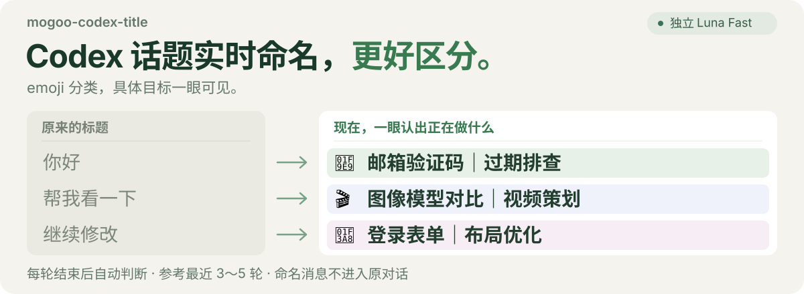

# mogoo-codex-title

<p align="center">
  
</p>

让 Codex 的话题标题跟上你正在做的事情。每轮对话结束后，自动参考最近 3～5 轮内容更新标题，话题再多，也更容易找到。

这是 **MogooStudio 维护的 fork**：保留原版的官方账号命名方式，并增加 **中转站支持、本地可视化设置、Windows 密钥设置对话框和最后发言时间后缀**。默认仍使用官方 Luna Fast；中转站需要显式配置和启用。

## 一眼看出正在做什么

以下为命名效果示例：

| 原来的标题 | 更容易找回的标题 |
| --- | --- |
| 回应中文问候 | 🧩 邮箱验证码｜过期排查 |
| 确认注册功能 | 🧩 支付回调｜重复发货修复 |
| 讨论视频标题 | 🎬 图像模型评测｜视频策划 |
| 继续修改 | 🎨 登录表单｜布局优化 |

标题核心采用 **「类别 emoji + 对象｜目标」**，先找对象，再看正在做什么。默认在末尾追加最后一条用户消息的发送时间，例如 **「🧩 中转站配置｜模式切换 · 10-08 14:30」**；示例时间仅用于展示格式。

- **对象在前**：把“CRT 转场”“登录表单”等辨识词放到前面，默认省略外层已有的项目名。
- **类别固定**：🎬 内容制作、🧩 工具开发、🔎 对比调研、🎨 页面设计、📝 方法整理。同一个视频进入修改阶段，也不会因此换成开发图标。
- **名称稳定**：准确的对象名称尽量不变；旧标题整理一次，之后只在工作目标实质变化时更新；“继续”“推送”不会取代主线。
- **最后发言时间**：按本机时区显示 `MM-DD HH:mm`，由程序读取消息时间后追加，不让模型猜日期。仅时间变化无需调用模型，锁定和手动标题仍受保护。
- **不打断对话**：独立模型在后台命名，默认 Luna Fast，也可使用中转站模型，不往原对话里添加消息。
- **跟随你的语言**：根据最近几轮用户消息的主要语言命名，保留产品名；偶尔一句外语不会让标题来回切换。例如：🧩 Email verification｜Fix expiry。
- **减少重复消耗**：稳定标题后的简单确认可直接保留，支持查看命名与归档评估的实际用量。
- **由你控制**：可以预览新标题、固定喜欢的名称，也可以随时暂停或恢复自动命名。
- **可选中转站**：自定义 API 基础地址、模型和密钥环境变量，官方与中转站分别保存配置，来回切换不覆盖另一种模式。
- **可视化设置**：在本地页面选择模式、编辑模型和 Fast 档位，点击保存后生效；外部修改冲突会提示重新读取。
- **Windows 密钥对话框**：点击环境变量名右侧的「设置密钥」，用隐藏输入保存 API Key 到当前用户环境变量。
- **适应桌面更新**：旧 Codex 程序被更新清理后，自动重新查找可用程序，避免固定版本路径导致后台命名持续失败。
- **可选闲置归档**：定期收起长期未聊、已经完成的话题，保护置顶与待办。先预览再开启；已归档话题不再参与模型评估，相同内容也不会每天重复判断。

## 让 Codex 帮你安装

复制下面这段话发给 Codex：

```text
帮我从 GitHub 仓库 MogooStudio/oil-codex-title 安装完整插件，使用仓库内的 mogoo-codex-title 插件市场，开启话题自动命名并检查是否生效。需要我在界面中信任 Hook 的步骤，请告诉我怎么操作。
```

安装后，在新话题里正常聊天即可。默认使用 Luna Fast，消耗当前 Codex 账号的模型额度。

### 命令行安装

```sh
codex plugin marketplace add MogooStudio/oil-codex-title --ref main
codex plugin add mogoo-codex-title@mogoo-codex-title
```

### 后续更新

```sh
codex plugin marketplace upgrade mogoo-codex-title
codex plugin add mogoo-codex-title@mogoo-codex-title
```

安装和更新不会自动信任 Hook；请在 Codex 官方 Hook 管理界面检查并信任新定义。

### Windows 后台命名

从 0.4.0 起，Hook 先把本轮检查交给后台 worker，再结束回调。若 Windows 的 Hook 运行在 Codex 沙箱身份下，还需配置当前用户的后台任务。可以直接对 Codex 说：

```text
帮我配置 mogoo-codex-title 的 Windows 后台 worker，检查用户身份、队列权限和任务状态，并告诉我怎样重新信任新版 Hook。
```

任务只处理本插件的标题队列，使用当前登录用户的身份；不会改变中转站 / 官方模式。升级到本版后需重新信任 Hook。配置命令、撤销方法和实际触发验收见 [Windows 后台队列说明](docs/Windows队列与worker.md)。

### 从旧名称或来源迁移

从 0.4.3 起，插件、市场和管理技能统一使用 `mogoo-codex-title`。GitHub 仓库地址仍是 `MogooStudio/oil-codex-title`，原作者出处和许可继续保留。

若已安装旧名称插件，先通过官方插件管理入口停用或卸载旧 Hook，再按上面的新市场安装命令安装，避免两个插件同时命名。旧 fork 的卸载命令为：

```sh
codex plugin remove oil-codex-title@mogoo-oil-title
```

其他来源按实际市场名卸载，例如 `oil-codex-title@personal`；通过官方市场管理入口处理不再使用的旧来源，保留其中其他插件。刷新钩子页面并信任新版定义，核对只启用 `mogoo-codex-title`。

新旧命令共用原来的数据目录、模型配置、密钥环境变量、锁定状态和用量记录，旧的 `scripts/oil_codex_title.py` 仍可使用。已配置 Windows worker 的用户，安装后再执行一次新入口的 `worker-setup`，更新缓存查找逻辑；沿用原计划任务和队列，不另建一套任务。详见 [Windows 队列说明](docs/Windows队列与worker.md)。

## 发一句话切换

**推荐安装后直接在 Codex 聊天中发送一句话，不用执行命令或寻找设置页面。**

| 想做什么 | 发给 Codex 的话 |
| --- | --- |
| 切换到中转站 | 把标题插件切到中转站。 |
| 切回官方账号 | 把标题插件切回官方账号。 |
| 查看当前模式 | 看看标题插件现在用哪种模式。 |
| 打开图形化设置 | 打开标题插件设置页面。 |

这里的「标题插件」指 `mogoo-codex-title`。也可以明确说「把 mogoo-codex-title 切换到中转站，使用之前保存的配置」。

已保存中转站配置后，Codex 会复用对应的地址、模型、档位和密钥环境变量名，不需要重新填写；完成后会反馈当前模式。首次尚未配置中转站时，先通过下面的设置页面完成配置。

**模式切换在下一次标题命名调用中生效。** 仅切换已保存的模式不需要重启；设置或修改密钥后，需要完全退出并重启 Codex。上述操作控制标题插件的命名服务。

想自己点击切换时，对 Codex 说「打开标题插件设置页面」，然后选择官方或中转站、点击「保存配置」。Codex 原生插件详情页的启用开关用于启停插件、技能或 Hook，本插件的模式选择在独立的本地设置页面中。

## 选择模型服务

| 配置 | 官方账号 `official` | 中转站 `relay` |
| --- | --- | --- |
| 是否默认启用 | 是，沿用原版方式 | 否，需要显式选择 |
| 模型 | 默认 `gpt-5.6-luna` | 填写中转站支持的准确模型 ID |
| 服务档位 | 默认 Fast（`priority`） | 默认标准，支持时可手动开启 Fast |
| 认证 | 复用 Codex 官方登录 | 从指定环境变量读取 API Key |
| 模型接口 | 原版官方调用方式 | 配置的 API 基础地址下的 `/responses` |

两种模式分别保存模型与档位，切回官方时恢复此前的官方配置。中转站配置也用于独立归档评估，用量账本记录实际调用的模型和档位。

中转站必须兼容 **Responses API、流式响应和 JSON Schema 输出**；只提供 `/chat/completions` 的服务不适用。请使用服务提供的 API 基础地址（例如 `https://relay.example/v1`），不要直接填写完整 `/responses` 地址。插件不会自动继承 Codex 主对话的中转站配置。

## 可视化设置

直接对 Codex 说：**「打开 mogoo-codex-title 的设置页面。」**

也可以在插件目录启动。Windows：

```powershell
py -3 scripts/mogoo_codex_title.py settings
```

macOS / Linux：

```sh
python3 scripts/mogoo_codex_title.py settings
```

程序会打开本地设置页，仅监听 `127.0.0.1`；关闭命令进程即停止服务。使用 `settings --no-browser` 可以只输出入口地址，让 Codex 打开到浏览器面板。

首次启用中转站：

1. 选择「自定义中转站」，填写 API 基础地址、模型 ID 和密钥环境变量名，例如 `OIL_TITLE_RELAY_KEY`。
2. Windows 点击变量名右侧的「设置密钥」，在隐藏输入的对话框中录入 API Key，然后点击「保存密钥」。macOS / Linux 通过系统环境变量配置密钥。
3. 点击页面底部的「保存配置」，才会切换模式并保存模型设置。
4. 保存密钥后，完全退出并重启 Codex，让后台 Hook 继承新的环境变量。

**保存密钥和保存配置是两次独立操作。** 密钥保存不会切换模式或覆盖未保存的模型草稿；模式和模型保存后在下次命名调用中生效。更换模型时默认回到标准档位，可在服务和模型支持时重新开启 Fast。

密钥写入 Windows 当前用户环境变量，已有值会被覆盖；不会写入插件配置、日志或命令行参数，也不会回传已有密钥。对话框关闭、取消或提交后清空输入。用户环境变量不是加密凭据仓库。

页面与后台 Hook 共用配置。「重新读取」会放弃当前草稿；如果命令行或另一个页面修改了配置，保存会提示冲突，重新读取后再编辑。详见 [可视化设置与数据边界](docs/使用与边界.md#本地可视化设置)。

## 命令行配置与切换

以下命令在插件目录运行，Windows 把 `python3` 换成 `py -3`。首次配置中转站前，先设置指定的密钥环境变量，并替换示例地址和模型名：

```sh
python3 scripts/mogoo_codex_title.py configure --provider relay --base-url "https://relay.example/v1" --api-key-env OIL_TITLE_RELAY_KEY --model "你的模型ID"
```

之后可以在已保存的两种配置之间切换，或查看当前状态：

```sh
python3 scripts/mogoo_codex_title.py configure --provider official
python3 scripts/mogoo_codex_title.py configure --provider relay
python3 scripts/mogoo_codex_title.py status
python3 scripts/mogoo_codex_title.py doctor
```

`--model` 和 `--service-tier` 修改当前选中的模式，也可以在同一命令中通过 `--provider` 指定。中转站和模型支持 Fast 时，可执行 `configure --provider relay --service-tier fast`；使用 `--service-tier standard` 恢复标准档位。

密钥缺失、模型调用失败或超时时保留原标题，不自动回退到官方账号。`doctor` 只检查配置、密钥存在状态、App Server 和 Hook 定义，不能证明模型连通性或自动命名已触发。完整说明见 [中转站配置](docs/使用与边界.md#可选中转站配置)。

## 标题末尾的时间

默认结构为 **「类别 emoji + 对象｜目标 · 最后用户发言时间」**。时间取最后一条用户消息的发送 / 创建记录，使用本机时区，精确到分钟；它不是助手完成回答的时间，也不是标题更新时间。命名模型仍只生成标题核心，时间后缀由程序维护。

只有时间变化，或稳定标题后新增纯确认时，可以独立更新后缀而不增加命名模型调用。程序只通过官方标题接口写入，不改写会话记录。读取不到可核验的消息时间时不追加，不用当前处理时间代替；新生成的核心最多 48 个字符，含 14 字符后缀最多 62 个字符。既有的更长标题继续保留，不截断任务名；窄侧边栏可能折叠长标题。

设置页提供「显示最后发言时间」开关，保存后在下一次标题检查生效。也可以对 Codex 说「隐藏标题后面的发言时间」或「显示标题后面的最后发言时间」。命令行：

```sh
python3 scripts/mogoo_codex_title.py configure --title-time off
python3 scripts/mogoo_codex_title.py configure --title-time on
```

这是两种模型服务共用的标题显示设置。手动改名、锁定、暂停和归档保护优先；关闭时只移除本插件记录的时间后缀，用户自己写在标题中的日期属于正文。升级后仅处理正常触发的话题，不批量改名历史对话。

## 日常怎么用

直接对 Codex 说：

- “预览这个话题的新标题。”
- “固定这个话题的标题。”
- “暂停自动命名。” / “恢复自动命名。”
- “打开设置页面，切换到中转站。” / “切回官方账号命名。”
- “预览可以归档的闲置话题。” / “每天帮我整理闲置话题。”

## 兼容性与验证

需要 Python 3.10+ 和兼容的本地 Codex CLI。此前版本的 Windows、macOS、Linux 程序测试已通过；0.4.0 的后台队列需另外运行跨平台验证。Windows 密钥对话框的注册表写入与读回使用隔离测试项验证。中转站真实模型调用已验证，各宿主的 Stop Hook 自动触发和桌面显示仍需分别验收，不能以 `doctor` 成功替代。

目前为**预览版**，云端不支持此本地插件。部分桌面版本的置顶列表可能仍显示旧标题，可让 Codex「检查真实标题并同步桌面显示」。

## 来源与维护

由 **MogooStudio** 维护此 fork，基于 [oil-oil/oil-codex-title](https://github.com/oil-oil/oil-codex-title)，保留原作者的 MIT 版权声明。

[详细使用与数据说明](docs/使用与边界.md) · [归档规则](docs/归档工作流.md) · [更新记录](CHANGELOG.zh.md) · [兼容性与验证记录](docs/发布验收.md) · [MIT 许可证](LICENSE)
